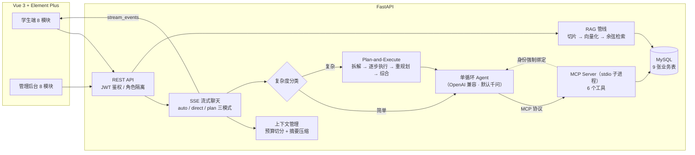

# 校园课程智能助手（course-agent）

基于 **AI Agent + MCP + RAG** 的全栈校园课程助手：学生通过自然语言与 Agent 对话，即可查询课表、检索个人课程资料、管理作业/成绩/学习计划；教师通过管理后台维护全部数据。前后端分离，工具层基于 MCP 协议与 Agent 解耦。

## 项目预览

| 课程助手（SSE 流式 + 工具调用卡片 + 表格渲染） | 我的课表 |
| --- | --- |
|  |  |
| **学习计划**（AI 拆解任务 + 进度打卡） | **复习卡片**（RAG 生成 + SRS 间隔重复） |
|  |  |
| **学习数据仪表盘** | **管理后台** |
|  |  |

## 架构



**核心设计**：

- **MCP 工具层与 Agent 解耦**：业务能力封装为独立 MCP Server（stdio 子进程），Agent 通过协议调用，工具可独立复用
- **多租户身份强制绑定**：`UserBoundTool` 包装层无论模型传入什么 `user_id`，执行前一律覆盖为当前登录用户，从协议层面杜绝越权（水平越权返回 404）
- **写操作审批（human-in-the-loop）**：`save_study_plan` 等写工具执行前经 SSE 发出 `approval_required`，前端弹窗确认后由独立接口回传决策；超时未决按拒绝处理（fail-closed），拒绝的步骤标记 skipped 且不触发重规划，后续**不依赖**它的步骤照常执行
- **三模式路由（auto/direct/plan）**：auto 模式先用轻量分类判断复杂度——简单问题走单循环，复杂任务走 **Plan-and-Execute**：LLM 拆解为带依赖的结构化步骤 → **就绪批次并发执行**（`depends_on` 构成 DAG，无依赖步骤 `asyncio.gather` 并行）→ 单步失败先指数退避重试 → 重试耗尽把失败上下文喂回 LLM **重规划**（批次级，新步骤 id 平移防冲突）→ 流式综合产出；规划失败自动降级单循环，保证有回答
- **两级上下文管理**：历史超字符预算（默认 8000）时，旧消息（含上轮摘要）由 LLM 压缩为工作摘要持久化在会话上，近期消息保留原文——形成「摘要 + 近期原文」的长期记忆
- **混合检索 + 重排**：BM25 关键词与向量语义双路召回（各取 20 候选）→ RRF 融合（免调权重）→ 交叉编码器（bge-reranker）重排取 top-k；评测显示纯向量 Hit@1 96.67% → 混合后 **100%**（r26 bad case 修复）
- **RAG 个人知识库**：学生上传资料自动切片/向量化入库，检索按 `user_id` 过滤，Agent 回答附带溯源（文件名/切片/相似度）
- **日期感知**：系统提示注入当前日期与教学周，Agent 可换算「今天/明天/下周一」并判断周次范围内是否上课
- **观测性**：每条回答落库首字耗时/总耗时/工具调用痕迹/检索溯源/规划元数据（步骤状态、重规划次数、是否降级），学生端仪表盘与后台统计可视化

## 功能

### 学生端（8 模块）
| 模块 | 说明 |
|---|---|
| 课程助手 | SSE 流式对话、工具调用过程卡片、Markdown 表格渲染、会话历史管理 |
| 学习数据 | 消息数/工具调用分布/平均耗时/GPA/待办作业等统计与提醒 |
| 我的课表 | 周次课表 + 本周日期列 |
| 作业/DDL | 待办作业、逾期标红、完成打卡（Agent 可查询并帮你规划） |
| 课程资料 | 上传 pdf/docx/txt/md，自动入库为个人知识库 |
| 复习卡片 | 基于 RAG 检索个人资料，LLM 生成问答卡，翻卡复习 |
| 学习计划 | Agent 生成学习计划，支持查看/编辑/完成标记 |
| 成绩绩点 | 4.0 标准绩点换算、加权 GPA、最弱科目分析 |

### 管理后台（8 模块）
系统统计（10 项指标）、文档管理（预览/重新入库/删除）、课程管理、课表管理（节次冲突检测）、作业管理、成绩管理、用户管理（角色/重置密码/级联保护）。

### MCP 工具（6 个）
`get_my_schedule` · `search_course_documents` · `list_my_documents` · `save_study_plan` · `get_upcoming_assignments` · `get_my_scores`

## 快速开始

### 方式一：Docker Compose 一键启动（推荐）

环境要求：Docker + 本机 MySQL 8 + 任意 OpenAI 兼容 LLM 的 API Key（默认千问）

```bash
# 1. 项目根目录创建 .env，写入 API Key（默认接千问 DashScope 兼容模式）
echo LLM_API_KEY=sk-xxx > .env

# 2. 本机 MySQL 建库并创建容器访问账号
mysql -uroot -p -e "CREATE DATABASE IF NOT EXISTS course_agent CHARACTER SET utf8mb4; CREATE USER IF NOT EXISTS 'course'@'%' IDENTIFIED BY '123456'; GRANT ALL PRIVILEGES ON course_agent.* TO 'course'@'%'; FLUSH PRIVILEGES;"

# 3. 一键构建并启动后端 + 前端（通过 host.docker.internal 复用本机 MySQL）
docker compose up -d --build

# 4.（可选）写入演示数据
docker compose exec backend python -m app.seed
```

访问 http://localhost:5173 即可。容器后端与本地开发共用本机同一个 `course_agent` 库（数据互通，Navicat 直连可见），上传文件持久化在 `uploads` volume 中。

### 方式二：本地开发

环境要求：Python 3.11+、Node 18+、MySQL 8

```bash
# 1. 数据库
mysql -uroot -p -e "CREATE DATABASE course_agent CHARACTER SET utf8mb4;"

# 2. 后端
cd backend
python -m venv .venv && .venv\Scripts\activate     # Windows
pip install -r requirements.txt
# 配置 backend/.env：
#   DATABASE_URL=mysql+pymysql://root:密码@127.0.0.1:3306/course_agent?charset=utf8mb4
#   LLM_API_KEY=sk-xxx                   # 默认千问；换 DeepSeek 等只需改 LLM_BASE_URL/LLM_MODEL
#   SEMESTER_START=2026-09-07          # 开学日期（用于推算教学周）
python -m app.seed                   # 建表 + 演示数据
python -m uvicorn app.main:app --port 8000

# 3. 前端
cd frontend
npm install
npm run dev                          # http://localhost:5173
```

测试账号：`student01/student01`（学生）、`admin01/admin01`（管理员）

## 技术栈

Vue 3 · Element Plus · vue-router · FastAPI · SQLAlchemy 2.0 · MySQL 8 · LangChain · MCP（FastMCP） · 千问 Qwen（OpenAI 兼容接口，可切换） · SSE · JWT

## 测试

后端内置 **149 个 pytest 用例**，覆盖权限绑定、RAG 检索隔离、分块入库、JWT 鉴权、MCP 工具、Agent 规划执行（重试/重规划/上下文压缩/写操作审批/并行依赖调度）与 API 集成，全部离线可跑（无需 API Key）：

```bash
cd backend
pip install -r requirements-dev.txt
python -m pytest                          # 全量（约 30 秒）
python -m pytest tests/test_planner.py -v # 单文件
```

| 测试文件 | 覆盖内容 |
|---|---|
| `test_user_binding.py` | **UserBoundTool 权限绑定**：模型传入伪造 `user_id=999` 被强制覆盖为登录用户（同步/异步） |
| `test_retriever.py` | 余弦相似度、检索按 `user_id` 隔离、跳过未就绪文档、top-k 截断、空向量跳过 |
| `test_hybrid_retrieval.py` | 中文二元分词、BM25 打分、RRF 融合、r26 场景向量排错被关键词捞回 |
| `test_indexer.py` | 分块长度约束、内容不丢、入库置 ready、空文档置 failed |
| `test_mcp_tools.py` | 6 个 MCP 工具直调：GPA 加权计算、逾期作业窗口、跨用户数据隔离 |
| `test_security.py` | 密码哈希盐值、JWT 签发/过期/错误密钥拒绝、admin 角色守卫、绩点换算 20 个边界值 |
| `test_resilience.py` | 指数退避重试：瞬时故障恢复、次数耗尽抛出、不可重试异常直抛、退避序列 1s→2s→4s |
| `test_context.py` | 上下文预算切分、超预算摘要压缩、旧摘要合并进新摘要、预算内不触发 |
| `test_planner.py` | 复杂度分类（失败降级 simple）、JSON 容错与一次修复、计划步数上限、重规划带失败上下文 |
| `test_plan_executor.py` | 执行循环：单步重试、失败重规划、重规划耗尽降级、部分成功仍综合、综合失败回退拼接 |
| `test_approval.py` | **写操作审批**：注册表/超时拒绝/归属校验、门控工具拒绝时底层不执行、执行器 skipped 语义不重试不降级 |
| `test_parallel_plan.py` | **并行调度**：依赖解析（前向引用剔除保证无环）、事件门证明并发、扇出扇入 DAG、阻塞跳过、批次级重规划、id 平移 |
| `test_chat_modes.py` | 模式路由 SSE 事件序列、plan 元数据落库、规划失败降级 direct、摘要持久化 |
| `test_api.py` | 登录注册、课表/计划/会话跨用户 404、学生访问管理接口 403、`/chat` 无 Key 时 SSE 优雅报错 |

每个用例使用独立 SQLite 测试库并在前后重建表，用例之间完全隔离。

**真实 Key E2E**（`scripts/e2e_approval.py`，需 `LLM_API_KEY`）：plan 模式 4 步任务实测——LLM 自主给出依赖 `[{},{},{},{1,2,3}]`（三路扇出 + 汇聚），`step_end` 顺序 `#1→#3→#2` 证明并发交织，`save_study_plan` 触发 `approval_required` → 决策 200 → 步骤完成，全链路 `4/4 done, 0 failed`。

## 评测（Evaluation）

基于黄金评测集量化 RAG 检索、工具选择与任务规划三层质量：语料为 5 篇课程文档，评测集含 30 条检索 + 12 条工具选择 + 6 条规划查询：

```bash
cd backend
python scripts/eval.py retrieval   # 检索评测（离线，无需 Key）
python scripts/eval.py tools       # 工具选择评测（需 LLM_API_KEY）
python scripts/eval.py plan        # 规划质量评测（需 Key）
python scripts/eval.py all         # 全部
```

评测使用独立数据库 `data/eval/eval.db`，不污染开发数据；结果写入 `data/eval/results.json`。

**检索评测实测结果**（top-3，30 条查询；混合管线 = BM25+向量 RRF 召回 + bge-reranker 重排）：

| 查询分层 | 条数 | 纯向量 Hit@1 | 混合管线 Hit@1 | 混合 Hit@3 | 混合 MRR |
|---|---|---|---|---|---|
| 常规查询（语义直接匹配） | 25 | 100.00% | 100.00% | 100.00% | 1.0000 |
| 困难查询（换措辞/无关键词重合） | 5 | 80.00% | **100.00%** | 100.00% | 1.0000 |
| **总体** | **30** | **96.67%** | **100.00%** | **100.00%** | **1.0000** |

失败样本 r26（「性能计时和缓存这类横切关注点」期望命中《程序设计基础讲义》装饰器章节）暴露了纯向量检索在**查询与文档无词汇重合**时的语义鸿沟——评测集刻意保留该 bad case 以量化改进空间，混合管线将其修复（消融实验：`RAG_HYBRID=0 RAG_RERANK=0` 可复现纯向量基线）。重排阶段在本评测集上无进一步增益（混合召回已全部命中第一），其价值在更大候选池与更难查询，管线中作为可配置开关保留。

**工具选择评测实测结果**（qwen3.8-flash，12 条自然语言指令，统计期望工具是否被调用）：

| 指标 | 结果 |
|---|---|
| 工具命中率 | **100.00%（12/12）** |

12 条指令覆盖全部 6 个工具。评测同时观察到：复杂指令（t10/t11「制定计划并保存」）会触发多工具串行调用（查课表 → 查成绩 → 查作业 → 查资料 → 保存计划），单工具指令则平均一次命中——说明模型在简单意图下没有过度调用。

**规划质量评测实测结果**（qwen3.8-flash，6 条查询：4 复杂 + 2 简单）：

| 指标 | 结果 |
|---|---|
| 复杂度分类准确率 | **83.33%（5/6）** |
| 计划工具覆盖率（均值） | **100.00%** |
| 完全覆盖率 | **100.00%（6/6）** |

分类的唯一 miss：p05「我 GPA 是多少，哪门最弱？」被判为复杂（实际单次 `get_my_scores` 即可）——分类器对「含比较但单工具可答」的边界情形偏保守。工具覆盖 100% 表示 4 条复杂查询拆出的计划均包含全部期望工具，规划阶段不会漏工具。
