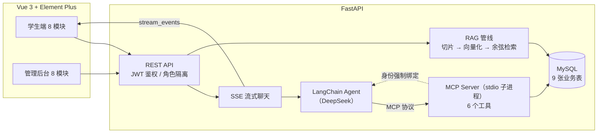

# 校园课程智能助手（course-agent）

基于 **AI Agent + MCP + RAG** 的全栈校园课程助手：学生通过自然语言与 Agent 对话，即可查询课表、检索个人课程资料、管理作业/成绩/学习计划；教师通过管理后台维护全部数据。前后端分离，工具层基于 MCP 协议与 Agent 解耦。

## 项目预览

| 课程助手（SSE 流式 + 工具调用卡片 + 表格渲染） | 我的课表 |
| --- | --- |
|  |  |
| **学习计划**（AI 拆解任务 + 进度打卡） | **复习卡片**（RAG 生成 + SRS 间隔重复） |
|  |  |
| **学习数据仪表盘** | **管理后台** |
|  |  |

## 架构



**核心设计**：

- **MCP 工具层与 Agent 解耦**：业务能力封装为独立 MCP Server（stdio 子进程），Agent 通过协议调用，工具可独立复用
- **多租户身份强制绑定**：`UserBoundTool` 包装层无论模型传入什么 `user_id`，执行前一律覆盖为当前登录用户，从协议层面杜绝越权（水平越权返回 404）
- **RAG 个人知识库**：学生上传资料自动切片/向量化入库，检索按 `user_id` 过滤，Agent 回答附带溯源（文件名/切片/相似度）
- **多轮记忆**：会话历史最近 20 条拼入 Agent 输入，支持「这门课的老师是谁」类代词追问
- **日期感知**：系统提示注入当前日期与教学周，Agent 可换算「今天/明天/下周一」并判断周次范围内是否上课
- **观测性**：每条回答落库首字耗时/总耗时/工具调用痕迹/检索溯源，学生端仪表盘与后台统计可视化

## 功能

### 学生端（8 模块）
| 模块 | 说明 |
|---|---|
| 课程助手 | SSE 流式对话、工具调用过程卡片、Markdown 表格渲染、会话历史管理 |
| 学习数据 | 消息数/工具调用分布/平均耗时/GPA/待办作业等统计与提醒 |
| 我的课表 | 周次课表 + 本周日期列 |
| 作业/DDL | 待办作业、逾期标红、完成打卡（Agent 可查询并帮你规划） |
| 课程资料 | 上传 pdf/docx/txt/md，自动入库为个人知识库 |
| 复习卡片 | 基于 RAG 检索个人资料，LLM 生成问答卡，翻卡复习 |
| 学习计划 | Agent 生成学习计划，支持查看/编辑/完成标记 |
| 成绩绩点 | 4.0 标准绩点换算、加权 GPA、最弱科目分析 |

### 管理后台（8 模块）
系统统计（10 项指标）、文档管理（预览/重新入库/删除）、课程管理、课表管理（节次冲突检测）、作业管理、成绩管理、用户管理（角色/重置密码/级联保护）。

### MCP 工具（6 个）
`get_my_schedule` · `search_course_documents` · `list_my_documents` · `save_study_plan` · `get_upcoming_assignments` · `get_my_scores`

## 快速开始

### 方式一：Docker Compose 一键启动（推荐）

环境要求：Docker + 本机 MySQL 8 + DeepSeek API Key

```bash
# 1. 项目根目录创建 .env，写入 API Key
echo DEEPSEEK_API_KEY=sk-xxx > .env

# 2. 本机 MySQL 建库并创建容器访问账号
mysql -uroot -p -e "CREATE DATABASE IF NOT EXISTS course_agent CHARACTER SET utf8mb4; CREATE USER IF NOT EXISTS 'course'@'%' IDENTIFIED BY '123456'; GRANT ALL PRIVILEGES ON course_agent.* TO 'course'@'%'; FLUSH PRIVILEGES;"

# 3. 一键构建并启动后端 + 前端（通过 host.docker.internal 复用本机 MySQL）
docker compose up -d --build

# 4.（可选）写入演示数据
docker compose exec backend python -m app.seed
```

访问 http://localhost:5173 即可。容器后端与本地开发共用本机同一个 `course_agent` 库（数据互通，Navicat 直连可见），上传文件持久化在 `uploads` volume 中。

### 方式二：本地开发

环境要求：Python 3.11+、Node 18+、MySQL 8

```bash
# 1. 数据库
mysql -uroot -p -e "CREATE DATABASE course_agent CHARACTER SET utf8mb4;"

# 2. 后端
cd backend
python -m venv .venv && .venv\Scripts\activate     # Windows
pip install -r requirements.txt
# 配置 backend/.env：
#   DATABASE_URL=mysql+pymysql://root:密码@127.0.0.1:3306/course_agent?charset=utf8mb4
#   DEEPSEEK_API_KEY=sk-xxx
#   SEMESTER_START=2026-09-07          # 开学日期（用于推算教学周）
python -m app.seed                   # 建表 + 演示数据
python -m uvicorn app.main:app --port 8000

# 3. 前端
cd frontend
npm install
npm run dev                          # http://localhost:5173
```

测试账号：`student01/student01`（学生）、`admin01/admin01`（管理员）

## 技术栈

Vue 3 · Element Plus · vue-router · FastAPI · SQLAlchemy 2.0 · MySQL 8 · LangChain · MCP（FastMCP） · DeepSeek API · SSE · JWT

## 测试

后端内置 **77 个 pytest 用例**，覆盖权限绑定、RAG 检索隔离、分块入库、JWT 鉴权、MCP 工具与 API 集成，全部离线可跑（无需 API Key）：

```bash
cd backend
pip install -r requirements-dev.txt
python -m pytest                          # 全量（约 10 秒）
python -m pytest tests/test_user_binding.py -v   # 单文件
```

| 测试文件 | 覆盖内容 |
|---|---|
| `test_user_binding.py` | **UserBoundTool 权限绑定**：模型传入伪造 `user_id=999` 被强制覆盖为登录用户（同步/异步） |
| `test_retriever.py` | 余弦相似度、检索按 `user_id` 隔离、跳过未就绪文档、top-k 截断、空向量跳过 |
| `test_indexer.py` | 分块长度约束、内容不丢、入库置 ready、空文档置 failed |
| `test_mcp_tools.py` | 6 个 MCP 工具直调：GPA 加权计算、逾期作业窗口、跨用户数据隔离 |
| `test_security.py` | 密码哈希盐值、JWT 签发/过期/错误密钥拒绝、admin 角色守卫、绩点换算 20 个边界值 |
| `test_api.py` | 登录注册、课表/计划/会话跨用户 404、学生访问管理接口 403、`/chat` 无 Key 时 SSE 优雅报错 |

每个用例使用独立 SQLite 测试库并在前后重建表，用例之间完全隔离。

## 评测（Evaluation）

基于黄金评测集量化 RAG 检索质量与 Agent 工具选择准确率：语料为 5 篇课程文档，评测集含 30 条检索查询 + 12 条工具选择查询：

```bash
cd backend
python scripts/eval.py retrieval   # 检索评测（离线，无需 Key）
python scripts/eval.py tools       # 工具选择评测（需 DEEPSEEK_API_KEY）
python scripts/eval.py all         # 全部
```

评测使用独立数据库 `data/eval/eval.db`，不污染开发数据；结果写入 `data/eval/results.json`。

**检索评测实测结果**（BGE-small-zh + 余弦检索，top-3，30 条查询）：

| 查询分层 | 条数 | Hit@1 | Hit@3 | MRR |
|---|---|---|---|---|
| 常规查询（语义直接匹配） | 25 | 100.00% | 100.00% | 1.0000 |
| 困难查询（换措辞/无关键词重合） | 5 | 80.00% | 80.00% | 0.8000 |
| **总体** | **30** | **96.67%** | **96.67%** | **0.9667** |

唯一失败样本（r26「性能计时和缓存这类横切关注点」期望命中《程序设计基础讲义》装饰器章节）暴露了纯向量检索在**查询与文档无词汇重合**时的语义鸿沟，是引入混合检索（BM25 + 向量）与重排（rerank）的直接依据——评测集刻意保留该 bad case 以量化改进空间。

**工具选择评测**（需配置 `DEEPSEEK_API_KEY`）：对 12 条自然语言指令统计期望工具是否被调用，输出工具命中率。
