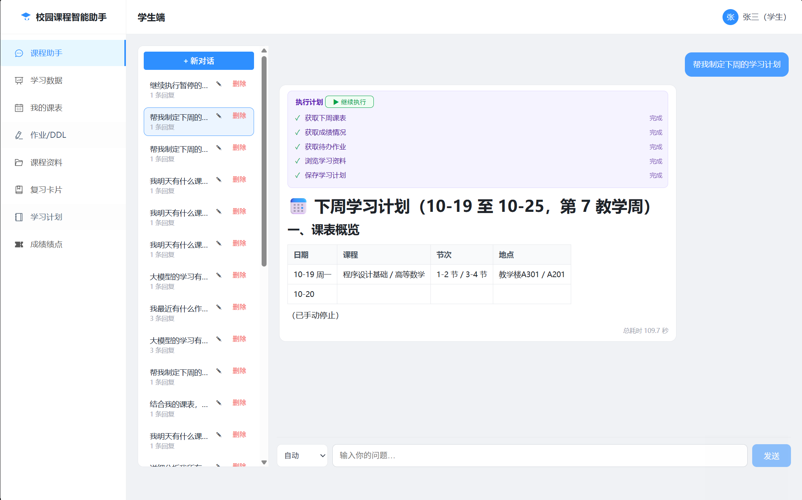
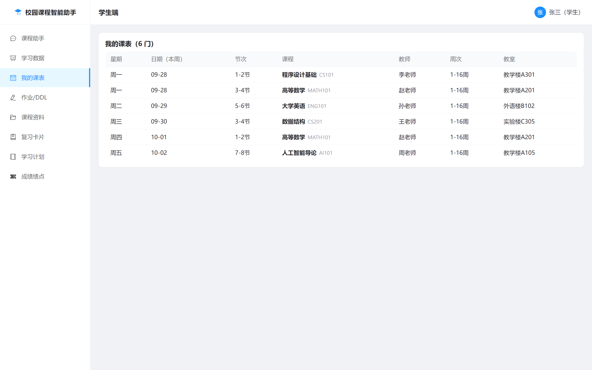
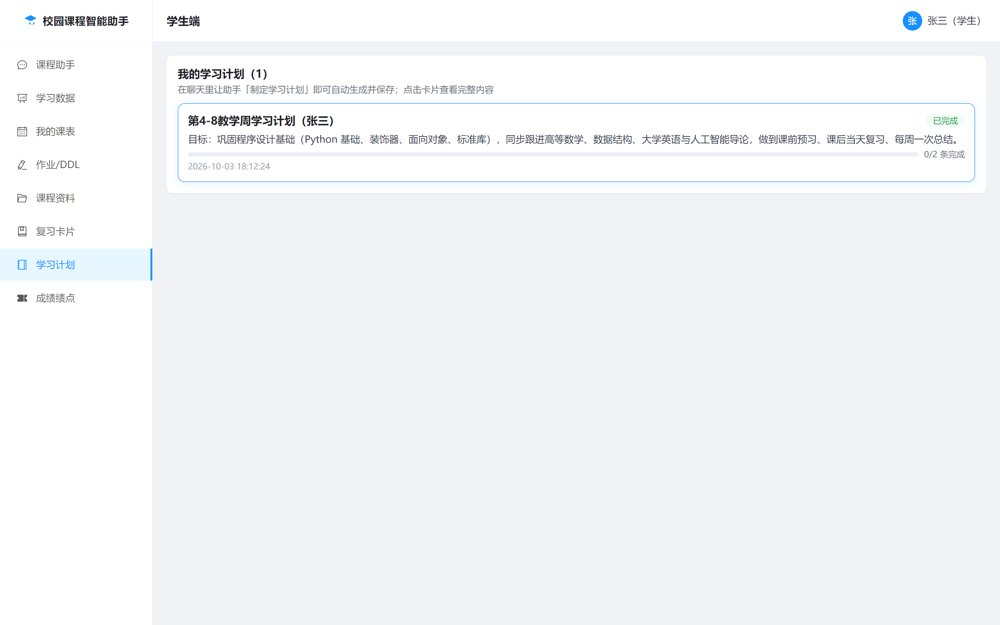
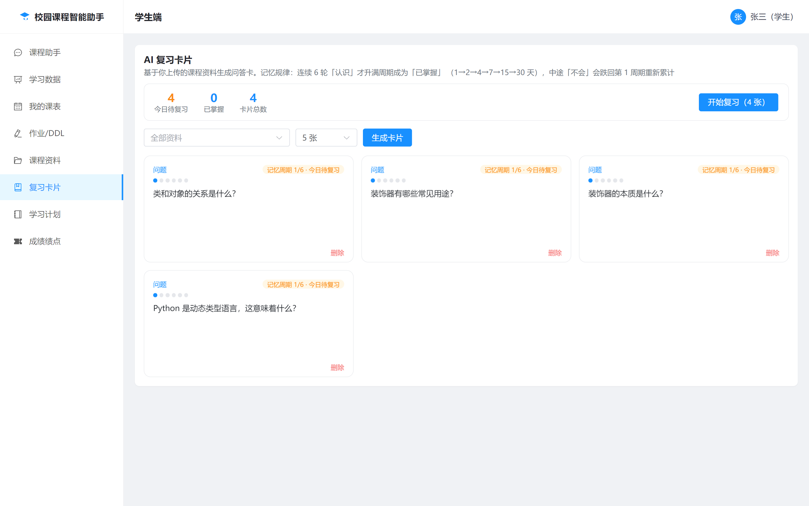
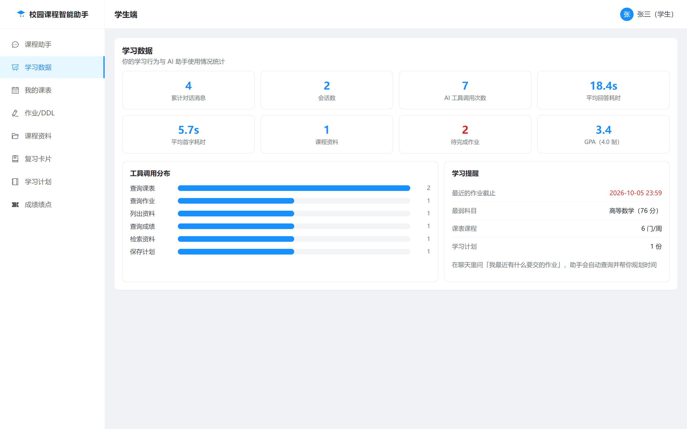
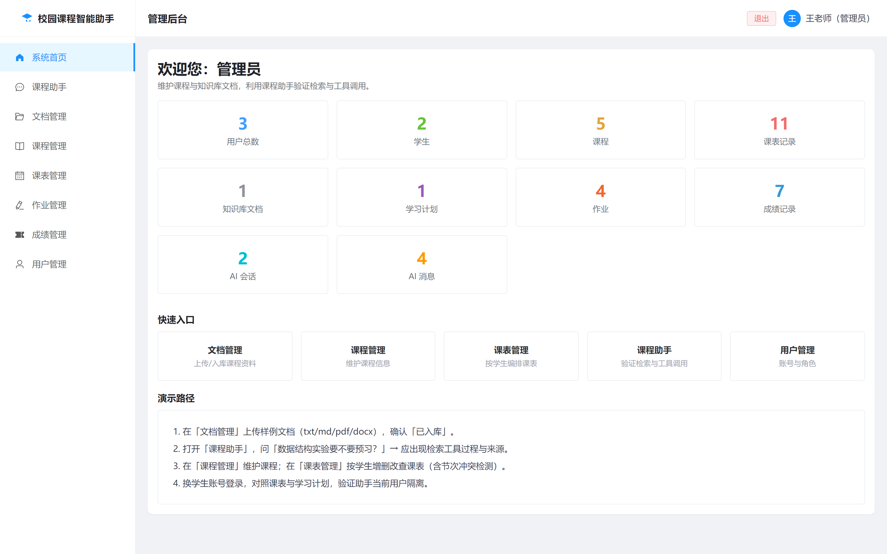
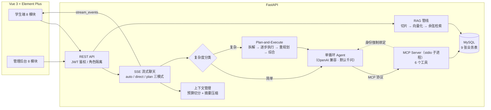

# 校园课程智能助手（course-agent）

基于 **AI Agent + MCP + RAG** 的全栈校园课程助手：学生通过自然语言与 Agent 对话，即可查询课表、检索个人课程资料、管理作业/成绩/学习计划；教师通过管理后台维护全部数据。前后端分离，工具层基于 MCP 协议与 Agent 解耦。

> 📐 **[设计文档（docs/design.md）](docs/design.md)**：函数级模块梳理 + 每节面试问答（含底层追问）+ 改进史与不足方案——面试前的梳理与深挖预案。

## 项目预览

| 课程助手（SSE 流式 + 工具调用卡片 + 表格渲染） | 我的课表 |
| --- | --- |
|  |  |
| **学习计划**（AI 拆解任务 + 进度打卡） | **复习卡片**（RAG 生成 + SRS 间隔重复） |
|  |  |
| **学习数据仪表盘** | **管理后台** |
|  |  |

## 架构



**核心设计**：

- **MCP 工具层与 Agent 解耦**：业务能力封装为独立 MCP Server（stdio 子进程），Agent 通过协议调用，工具可独立复用
- **多租户身份强制绑定**：`UserBoundTool` 包装层无论模型传入什么 `user_id`，执行前一律覆盖为当前登录用户，从协议层面杜绝越权（水平越权返回 404）
- **写操作审批（human-in-the-loop，三态）**：`save_study_plan` 等写工具执行前经 SSE 发出 `approval_required`，前端弹窗提供**允许 / 拒绝 / 修改后执行**三态——修改意见作为工具结果回传模型，同一轮内调整参数后重新发起审批（不整步重跑）；超时未决与修改轮数超限均按拒绝处理（fail-closed），拒绝的步骤标记 skipped 且不触发重规划，后续**不依赖**它的步骤照常执行；每次审批请求/决策落库 `approval_logs`，**人工干预率可度量**（评测输出 20%＝1/5 轮触发审批，决策分布 approve/reject/revise/timeout）
- **主备模型路由 + 熔断**：`LLM_ROUTES` 配置多模型路由，priority 升序主备、同级 weight 加权分流；同一路由连续失败达阈值熔断跳过、冷却后半开探测；`run_step` 每次重试前重新选路——故障切换粒度＝步骤重试，`failover` 事件实时通知前端；`build_llm` 统一经路由（闪卡生成/评测自动获得主备能力）
- **断点续跑（执行状态持久化 + 人工接管）**：`PlanRun` 表逐事件持久化计划全状态（plan/step_end/replan 即时落库）；用户中途停止 → 计划标记 paused、消息携带续跑 id → 前端「▶ 继续执行」→ `resume_plan_id` 恢复执行，**done 步骤复用产出只补未完成部分**（中断时 running 的步骤复位重跑，写工具由幂等键兜底）；异常/断线由 finally 兜底暂停，不丢断点
- **反思环节**：综合产出后质量自检（1-5 分 + 问题点），低于阈值且给出修订则替换答案（`reflection` 事件整体替换正文，不与已流式内容重复）；fail-open——反思失败绝不影响已产出答案
- **限流与幂等**：每用户令牌桶限流（聊天按用户、登录按 IP 防爆破，429 带 Retry-After）；`save_study_plan` 服务端幂等——(user, 内容指纹) 窗口期去重，重试/重规划/模型重复保存返回既有计划（`deduplicated` 标记），从机制层取代提示词级护栏
- **三模式路由（auto/direct/plan）**：auto 模式先用轻量分类判断复杂度——简单问题走单循环，复杂任务走 **Plan-and-Execute**：LLM 拆解为带依赖的结构化步骤 → **就绪批次并发执行**（`depends_on` 构成 DAG，无依赖步骤 `asyncio.gather` 并行）→ 单步失败先指数退避重试 → 重试耗尽把失败上下文喂回 LLM **重规划**（批次级，新步骤 id 平移防冲突）→ 流式综合产出；规划失败自动降级单循环，保证有回答
- **跨步骤上下文传递 + 请求级事件去重**：每个步骤的指令注入已完成步骤的真实产出（并明确"禁止重复调用相同工具/重复保存"），从源头减少重复查询；SSE 侧按请求去重工具事件（`tool_start/tool_end` 每工具只上屏一次，`tool_records` 按 (name, input) 记录保留真实调用差异）——E2E 实测同一任务 13 条重复卡片降为 3~4 条
- **全程流式（含规划综合）**：步骤执行中 `step_text` 逐段实时上屏，最终综合走 `astream` 异步流式逐 chunk 下发——修复真实 bug：曾误用**同步** `.stream()` 配 `async for`，`TypeError` 被静默吞掉后永远走非流式回退（综合整段吐出）；修复后 E2E 实测单次回答 **399 个 text 增量 + 185 个 step_text 增量**逐段下发
- **会话体验**：对话可**重命名**（`PATCH /conversations/{id}`，越权 404、空标题 422）；侧栏计数 = **大模型回复次数**（只数 assistant）；**输入草稿按会话隔离**——切换会话输入框清空、切回草稿还原；**新对话懒创建**——点"新对话"不建库，发首条消息才落库，中途放弃不残留空白会话（请求失败产生的空白会话由服务端 finally 自动清理）
- **生成可中断**：请求携带 `run_id`，`POST /api/chat/cancel` 取消后台任务（归属校验防取消他人任务），SSE 以 `cancelled` 事件收尾并保留已生成的部分内容；前端"停止"按钮一键中断
- **两级上下文管理**：历史超字符预算（默认 8000）时，旧消息（含上轮摘要）由 LLM 压缩为工作摘要持久化在会话上，近期消息保留原文——形成「摘要 + 近期原文」的长期记忆
- **跨会话用户画像（三级记忆的第三级）**：`user_memories` 表按用户持久化画像，每收到 N 条（默认 4）助手消息节流刷新一次——LLM 把「旧画像 + 本会话近期对话」合并，只保留跨会话稳定信息（身份/偏好/薄弱科目），失败 best-effort 不阻断对话；画像注入系统提示，实现「跨会话记得你是谁」
- **Token/成本核算**：`UsageCollector` 挂在 LLM 实例回调上，一次请求聚合分类/规划/步骤/综合全部调用的 input/output token，按官网单价折算成本，落库 `ai_messages`（input_tokens/output_tokens/cost_cny）并在 SSE `done` 事件与仪表盘展示；`/api/stats/me` 聚合总额，评测脚本同样上报自身消耗
- **混合检索 + 重排**：BM25 关键词与向量语义双路召回（各取 20 候选）→ RRF 融合（免调权重）→ 交叉编码器（bge-reranker）重排取 top-k；评测显示纯向量 Hit@1 96.67% → 混合后 **100%**（r26 bad case 修复），优化后回归仍为 **Hit@1/Hit@3 100%、MRR 1.0**
- **检索工程化**：切片改递归字符切分（段落→句号→子句逐级降级、句子不切断）+ 相邻块 overlap；向量存 float32 BLOB（解码 2000×512 基准 **152x**）、余弦改 numpy 批量点积（**56x**，显式归一化防脏数据）；检索结果多样性（同文档限流 + 相邻切片合并）；单例双重检查锁、脏切片容错、索引失败回滚、启动模型预热——基准与数字见 `scripts/bench_retrieval.py`
- **RAG 个人知识库**：学生上传资料自动切片/向量化入库，检索按 `user_id` 过滤，Agent 回答附带溯源（文件名/切片/相似度）
- **日期感知**：系统提示注入当前日期与教学周，Agent 可换算「今天/明天/下周一」并判断周次范围内是否上课
- **观测性**：每条回答落库首字耗时/总耗时/Token 成本/工具调用痕迹/检索溯源/规划元数据（步骤状态、重规划次数、是否降级），学生端仪表盘与后台统计可视化；后台统计含审批干预分布（approve/reject/revise/timeout）

## 功能

### 学生端（8 模块）
| 模块 | 说明 |
|---|---|
| 课程助手 | SSE 流式对话、工具调用过程卡片、Markdown 表格渲染、会话历史管理 |
| 学习数据 | 消息数/工具调用分布/平均耗时/GPA/待办作业等统计与提醒 |
| 我的课表 | 周次课表 + 本周日期列 |
| 作业/DDL | 待办作业、逾期标红、完成打卡（Agent 可查询并帮你规划） |
| 课程资料 | 上传 pdf/docx/txt/md，自动入库为个人知识库 |
| 复习卡片 | 基于 RAG 检索个人资料，LLM 生成问答卡，翻卡复习 |
| 学习计划 | Agent 生成学习计划，支持查看/编辑/完成标记 |
| 成绩绩点 | 4.0 标准绩点换算、加权 GPA、最弱科目分析 |

### 管理后台（8 模块）
系统统计（10 项指标）、文档管理（预览/重新入库/删除）、课程管理、课表管理（节次冲突检测）、作业管理、成绩管理、用户管理（角色/重置密码/级联保护）。

### MCP 工具（6 个）
`get_my_schedule` · `search_course_documents` · `list_my_documents` · `save_study_plan` · `get_upcoming_assignments` · `get_my_scores`

## 快速开始

### 方式一：Docker Compose 一键启动（推荐）

环境要求：Docker + 本机 MySQL 8 + 任意 OpenAI 兼容 LLM 的 API Key（默认千问）

```bash
# 1. 项目根目录创建 .env，写入 API Key（默认接千问 DashScope 兼容模式）
echo LLM_API_KEY=sk-xxx > .env

# 2. 本机 MySQL 建库并创建容器访问账号
mysql -uroot -p -e "CREATE DATABASE IF NOT EXISTS course_agent CHARACTER SET utf8mb4; CREATE USER IF NOT EXISTS 'course'@'%' IDENTIFIED BY '123456'; GRANT ALL PRIVILEGES ON course_agent.* TO 'course'@'%'; FLUSH PRIVILEGES;"

# 3. 一键构建并启动后端 + 前端（通过 host.docker.internal 复用本机 MySQL）
docker compose up -d --build

# 4.（可选）写入演示数据
docker compose exec backend python -m app.seed
```

访问 http://localhost:5173 即可。容器后端与本地开发共用本机同一个 `course_agent` 库（数据互通，Navicat 直连可见），上传文件持久化在 `uploads` volume 中。

### 方式二：本地开发

环境要求：Python 3.11+、Node 18+、MySQL 8

```bash
# 1. 数据库
mysql -uroot -p -e "CREATE DATABASE course_agent CHARACTER SET utf8mb4;"

# 2. 后端
cd backend
python -m venv .venv && .venv\Scripts\activate     # Windows
pip install -r requirements.txt
# 配置 backend/.env：
#   DATABASE_URL=mysql+pymysql://root:密码@127.0.0.1:3306/course_agent?charset=utf8mb4
#   LLM_API_KEY=sk-xxx                   # 默认千问；换 DeepSeek 等只需改 LLM_BASE_URL/LLM_MODEL
#   SEMESTER_START=2026-09-07          # 开学日期（用于推算教学周）
python -m app.seed                   # 建表 + 演示数据
python -m uvicorn app.main:app --port 8000

# 3. 前端
cd frontend
npm install
npm run dev                          # http://localhost:5173
```

测试账号：`student01/student01`（学生）、`admin01/admin01`（管理员）

## 技术栈

Vue 3 · Element Plus · vue-router · FastAPI · SQLAlchemy 2.0 · MySQL 8 · LangChain · MCP（FastMCP） · 千问 Qwen（OpenAI 兼容接口，可切换） · SSE · JWT

## 测试

后端内置 **247 个 pytest 用例**，覆盖权限绑定、RAG 检索隔离、分块入库、JWT 鉴权、MCP 工具、Agent 规划执行（重试/重规划/上下文压缩/写操作审批/并行依赖调度）、Token 成本核算、跨会话记忆、**工具去重与生成中断**、**会话重命名/计数/空白清理**、**模型路由/限流/幂等/反思/断点续跑**与 API 集成，全部离线可跑（无需 API Key）：

```bash
cd backend
pip install -r requirements-dev.txt
python -m pytest                          # 全量（约 35 秒）
python -m pytest tests/test_planner.py -v # 单文件
```

| 测试文件 | 覆盖内容 |
|---|---|
| `test_user_binding.py` | **UserBoundTool 权限绑定**：模型传入伪造 `user_id=999` 被强制覆盖为登录用户（同步/异步） |
| `test_retriever.py` | 余弦相似度、检索按 `user_id` 隔离、跳过未就绪文档、top-k 截断、空向量跳过 |
| `test_hybrid_retrieval.py` | 中文二元分词、BM25 打分、RRF 融合、r26 场景向量排错被关键词捞回 |
| `test_indexer.py` | 分块长度约束、内容不丢、入库置 ready、空文档置 failed |
| `test_mcp_tools.py` | 6 个 MCP 工具直调：GPA 加权计算、逾期作业窗口、跨用户数据隔离 |
| `test_security.py` | 密码哈希盐值、JWT 签发/过期/错误密钥拒绝、admin 角色守卫、绩点换算 20 个边界值 |
| `test_resilience.py` | 指数退避重试：瞬时故障恢复、次数耗尽抛出、不可重试异常直抛、退避序列 1s→2s→4s |
| `test_context.py` | 上下文预算切分、超预算摘要压缩、旧摘要合并进新摘要、预算内不触发 |
| `test_planner.py` | 复杂度分类（失败降级 simple）、JSON 容错与一次修复、计划步数上限、重规划带失败上下文 |
| `test_plan_executor.py` | 执行循环：单步重试、失败重规划、重规划耗尽降级、部分成功仍综合、综合失败回退拼接、**astream 逐段流式综合**（同步 stream 误用回归防线） |
| `test_approval.py` | **写操作审批（三态）**：注册表/超时拒绝/归属校验、门控工具拒绝时底层不执行、**revise 意见回传不计数/超限转拒/审批门 revise 文案**、执行器 skipped 语义不重试不降级 |
| `test_ratelimit.py` | **限流**：令牌桶容量/时间补充/容量封顶、聊天按用户隔离、未登录不耗配额、登录按 IP、配额 0 直通 |
| `test_router.py` | **主备模型路由**：熔断状态机（开/半开/闭合/重开）、优先级选路/跳过/全熔断、同级加权分流、配置解析、usage 挂载 |
| `test_reflection.py` | **反思**：质量分解析与夹取、低分无修订不替换、JSON 坏/LLM 失败 fail-open |
| `test_plan_resume.py` | **断点续跑**：状态还原、running 复位 pending、续跑只执行 pending 且注入 done 产出、正常完成终态化、取消→paused、越权续跑拒绝 |
| `test_parallel_plan.py` | **并行调度**：依赖解析（前向引用剔除保证无环）、事件门证明并发、扇出扇入 DAG、阻塞跳过、批次级重规划、id 平移 |
| `test_usage.py` | **Token 成本核算**：OpenAI usage 与 usage_metadata 双载体提取、多调用聚合、计价公式、空 usage 不计 |
| `test_memory.py` | **跨会话记忆**：画像节流刷新、跨会话持久与合并、LLM 失败 best-effort、阈值内零 LLM 调用 |
| `test_eval_report.py` | 评测结果按 suite 合并（修复单跑覆盖 bug）、坏文件恢复、目录自动创建 |
| `test_interrupt_dedup.py` | **工具去重**（同请求同工具只上屏一次）、**前序结果注入指令**（防重复查询+防重复保存）、**取消语义**（注册表/归属校验/CancelledError 收尾） |
| `test_chat_modes.py` | 模式路由 SSE 事件序列、plan 元数据落库、规划失败降级 direct、摘要持久化 |
| `test_api.py` | 登录注册、课表/计划/会话跨用户 404、学生访问管理接口 403、`/chat` 无 Key 时 SSE 优雅报错、**会话重命名（越权 404/空标题 422）**、**计数只数 assistant**、**失败请求不留空白会话** |

每个用例使用独立 SQLite 测试库并在前后重建表，用例之间完全隔离。

**真实 Key E2E**（`scripts/e2e_approval.py` / `scripts/e2e_fixes.py` / `scripts/e2e_stream_rename.py`，需 `LLM_API_KEY`）：
- **审批 + 并发**（e2e_approval）：plan 模式 4 步任务，LLM 自主给出依赖 `[{},{},{},{1,2,3}]`（三路扇出 + 汇聚），`step_end` 顺序 `#1→#3→#2` 证明并发交织，`save_study_plan` 触发 `approval_required` → 决策 200 → 全链路 `4/4 done, 0 failed`
- **去重 + 中断**（e2e_fixes）：同一任务 `tool_start` 仅 3~4 个（修复前 13 条含大量重复）；`run_id` + `POST cancel` → 流以 `cancelled` 收尾、重复取消 404、已生成部分落库标记「已手动停止」
- **流式 + 会话 + 三态审批 + 断点续跑**（e2e_stream_rename）：plan 综合逐段流式（单次回答 589 个 text 增量 + 274 个 step_text 增量，修复前整段 1 个）；侧栏计数 = assistant 条数；重命名 200 / 越权 404 / 空标题 422；**revise→模型调整→二次审批→批准** 全链路；**中途取消 → plan_run_id → 续跑只补未完成步骤 → 正常收尾**

## 评测（Evaluation）

基于黄金评测集量化**四层**质量：RAG 检索、工具选择、任务规划、端到端执行。语料为 5 篇课程文档，评测集含 30 条检索 + 12 条工具选择 + 6 条规划 + 5 条执行查询：

```bash
cd backend
python scripts/eval.py retrieval   # 检索评测（离线，无需 Key）
python scripts/eval.py tools       # 工具选择评测（需 LLM_API_KEY）
python scripts/eval.py plan        # 规划质量评测（需 Key）
python scripts/eval.py execution   # 端到端完成率（需 Key，含真实执行+DB断言）
python scripts/eval.py all         # 全部
```

评测使用独立数据库 `data/eval/eval.db`，不污染开发数据；结果按 suite **合并**写入 `data/eval/results.json`（单跑一个 suite 不覆盖其他 suite 的历史结果）。

**检索评测实测结果**（top-3，30 条查询；混合管线 = BM25+向量 RRF 召回 + bge-reranker 重排）：

| 查询分层 | 条数 | 纯向量 Hit@1 | 混合管线 Hit@1 | 混合 Hit@3 | 混合 MRR |
|---|---|---|---|---|---|
| 常规查询（语义直接匹配） | 25 | 100.00% | 100.00% | 100.00% | 1.0000 |
| 困难查询（换措辞/无关键词重合） | 5 | 80.00% | **100.00%** | 100.00% | 1.0000 |
| **总体** | **30** | **96.67%** | **100.00%** | **100.00%** | **1.0000** |

失败样本 r26（「性能计时和缓存这类横切关注点」期望命中《程序设计基础讲义》装饰器章节）暴露了纯向量检索在**查询与文档无词汇重合**时的语义鸿沟——评测集刻意保留该 bad case 以量化改进空间，混合管线将其修复（消融实验：`RAG_HYBRID=0 RAG_RERANK=0` 可复现纯向量基线）。重排阶段在本评测集上无进一步增益（混合召回已全部命中第一），其价值在更大候选池与更难查询，管线中作为可配置开关保留。

**工具选择评测实测结果**（qwen3.8-flash，12 条自然语言指令，统计期望工具是否被调用）：

| 指标 | 结果 |
|---|---|
| 工具命中率 | **100.00%（12/12）** |

12 条指令覆盖全部 6 个工具。评测同时观察到：复杂指令（t10/t11「制定计划并保存」）会触发多工具串行调用（查课表 → 查成绩 → 查作业 → 查资料 → 保存计划），单工具指令则平均一次命中——说明模型在简单意图下没有过度调用。

**规划质量评测实测结果**（qwen3.8-flash，6 条查询：4 复杂 + 2 简单）：

| 指标 | 结果 |
|---|---|
| 复杂度分类准确率 | **100.00%（6/6）**（首跑 83.33%，见下） |
| 计划工具覆盖率（均值） | **100.00%** |
| 完全覆盖率 | **100.00%（6/6）** |

**LLM 非确定性说明（诚实记录）**：首跑分类 83.33%，唯一 miss 是 p05「我 GPA 是多少，哪门最弱？」被判为复杂（实际单次 `get_my_scores` 即可）——分类器对「含比较但单工具可答」的边界情形偏保守；复跑 100%。同一评测集两次结果不同是 LLM 采样非确定性的直接证据，面试时可用作"为什么要多跑/要温度归零"的讨论素材。

**端到端执行评测实测结果**（qwen3.8-flash，5 条真实执行，真实 LLM + MCP + DB 断言，写操作由自动审批器批准）：

| 指标 | 结果 |
|---|---|
| **任务完成率** | **100.00%（5/5）** |
| 评测自身消耗 | 50,761 input + 14,451 output tokens / **¥0.0695** |

5 条用例覆盖：最弱科目查询（答案含「高等数学」）、周四课表（含「数据结构」）、RAG 溯源（含「装饰器」）、**plan 模式完整执行 + 计划落库断言**（`study_plans` 新增且条目 ≥3）、多工具组合查询（作业「实验」+ 分数「92」）。断言同时校验**答案内容**与**数据库状态**（如 `计划条目≥3`），不只是"没报错"——评测成本 ¥0.07 也顺带验证了成本核算链路。

## 已知局限

如实记录当前实现的边界与对应的改进方案（面试深挖预案）：

| 局限 | 现状 | 改进方案 |
|---|---|---|
| **审批/取消注册表是单进程内存**（`approval.py` 的 `PENDING`、`chat.py` 的 `ACTIVE_RUNS`） | 依赖 asyncio 单线程 + 单 worker 部署，跨进程无法传递 Future/任务句柄 | 多 worker 部署时换 Redis Pub/Sub 或数据库轮询解锁；横向扩容前必须处理 |
| **工具评测样本量小** | 12 条指令、6 条规划查询，统计置信有限 | 扩到 50+ 条并按工具/意图分层抽样 |
| **完成率评测依赖演示数据** | 断言基于 seed 数据的字段（GPA、课程名），换数据集需同步改断言 | 断言改为读数据库期望值而非硬编码 |
| **MCP 每请求拉起子进程** | 每次聊天 spawn 一次 stdio 子进程，冷启动有开销 | 常驻连接池或改用 streamable HTTP transport |
| **无 Alembic 迁移** | 列变更靠 `_ensure_columns` 手写 ALTER，表结构变更能力弱 | 正式项目引入 Alembic，出 revision 脚本 |
| **前端无测试** | 149 个测试全在后端 | 补 Vitest 覆盖 SSE 事件状态机与审批弹窗 |
